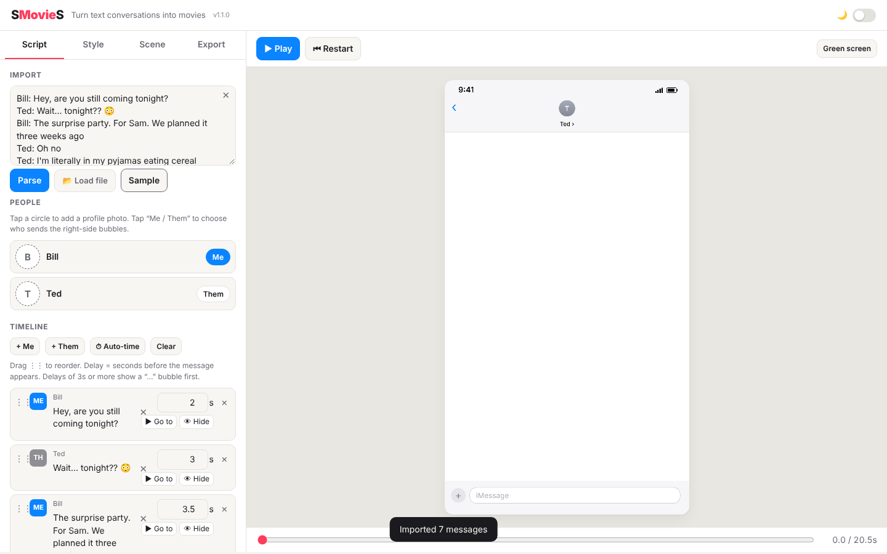
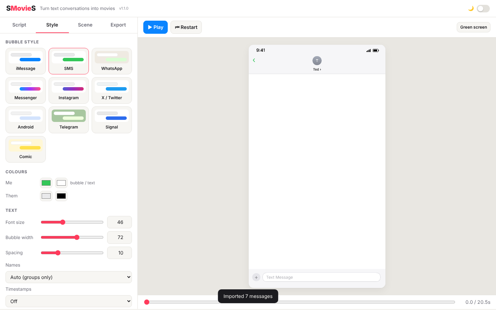
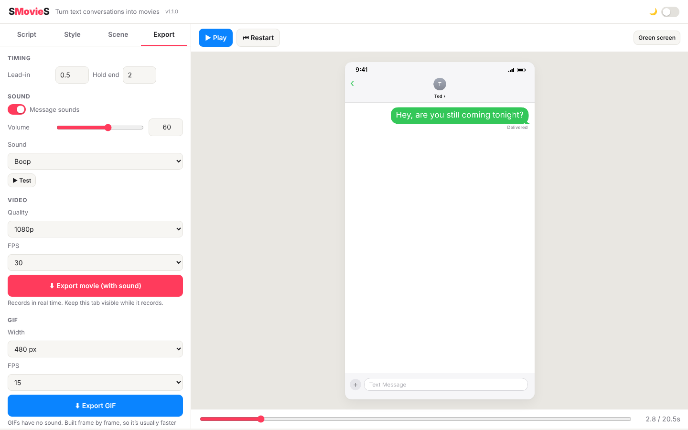

# SMovieS User Manual

This manual shows you how to turn a text conversation into a short movie or an animated GIF. You do not need any editing or computer experience. If you can copy and paste text and click buttons, you can use SMovieS.

Throughout this guide, "click" also means "tap" if you are using a phone or tablet.

---

## Contents

1. Opening the app
2. Understanding the screen
3. Step 1: Getting your conversation in (Script tab)
4. Step 2: Arranging the messages (Script tab)
5. Step 3: Choosing the look (Style tab)
6. Step 4: Choosing the background and frame (Scene tab)
7. Step 5: Previewing (the play bar)
8. Step 6: Exporting your movie or GIF (Export tab)
9. Using a phone or tablet
10. Troubleshooting
11. Glossary

---

## 1. Opening the app

Double-click `smovies.html`. It opens in your web browser. Nothing needs to be installed.


Click **Sample** on the left side of the screen to load an example conversation. This is a good way to learn the app before using your own messages.

---

## 2. Understanding the screen

The screen has two halves.

**Left side: the control panel**
- Four tabs across the top: **Script**, **Style**, **Scene** and **Export**. Click a tab to show its controls.

**Right side: the preview**
- **▶ Play** and **⏮ Restart** buttons sit above the preview.
- The **preview** shows your movie as it will look.
- The bar at the bottom is the **progress bar**. It shows how far through the movie you are, and the time on the right shows elapsed time and total length.

**Top-right corner:** the **🌙 switch** turns night mode on and off. Night mode makes the whole app darker, which is easier on the eyes in dim light.

---

## 3. Step 1: Getting your conversation in (Script tab)

The **Script** tab is where everything starts.



**Option A: paste text**
1. Copy the conversation text.
2. Click inside the large box under **Import** and paste it.
3. Click **Parse**. The messages appear in the **Timeline** list.

**Option B: load a file**
1. Click **📂 Load file**.
2. Choose your file. SMovieS accepts:
   - WhatsApp chat exports (`.txt`)
   - Instagram message exports (`.json`)
   - X (Twitter) direct-message archives (`.js`)

**What text format can I paste?**
- Plain lines like this:
  ```
  Bill: Hey, are you coming tonight?
  Ted: Wait... tonight??
  ```
- Lines that begin with `>` are sent by you, and lines that begin with `<` are sent by the other person.
- WhatsApp copy-and-paste lines, which begin with a date and time in square brackets.

**Tip:** If your text has the names of two people, SMovieS will guess which one is you. You can change this later in the **People** section.

---

## 4. Step 2: Arranging the messages (Script tab)

### The People section

Once messages are loaded, a **People** section lists each person in the conversation.

- **Add a photo:** click the circle with the person's initials, then choose a picture from your computer. The picture appears as their profile photo.
- **Remove a photo:** click the small **×** next to the person's name.
- **Choose the side:** click the **Me** or **Them** button to decide which side that person's messages appear on. Messages sent by **Me** appear on the right, in the coloured bubble. Messages from **Them** appear on the left.

### The Timeline section

The **Timeline** is the list of messages, shown in the order they will appear.

Each message has several parts:

| Part | What to do with it |
|------|--------------------|
| **⋮⋮** (grip, on the far left) | Press and drag to move the message up or down the list. |
| **ME** or **TH** button | Click to switch the message between the right side (me) and the left side (them). |
| The message text | Click in the box to edit the wording. |
| The number and **s** | The number of seconds to wait before this message appears. For example, `2` means the message appears two seconds after the previous one. You can type any number, including decimals such as `1.5`. |
| **×** | Delete the message. |

**Go to and Hide / Show (version 1.1):**
- **▶ Go to** jumps the preview to that message, so you can see exactly how it looks.
- **👁 Hide** removes a message from the movie without deleting it. Hidden messages appear faded with a dashed border. Click **👁 Show** to bring the message back.

**Clearing a text box (version 1.1):** every text box has a small **✕** in its top-right corner. Click it to empty that box.

**Adding messages:**
- **+ Me** adds a new message on your side.
- **+ Them** adds a new message on the other person's side.

**Clearing:** **Clear** removes every message. This cannot be undone, so be sure before you click it.

**Automatic timing:** **⏱ Auto-time** sets the wait time for every message based on how long each message is. Short messages get a short pause and long ones get a longer pause. Try this first, then adjust individual messages by hand if needed.

**The typing bubble:** if a message has a wait of three seconds or more, the app shows a "…" bubble first, as if the other person is typing. This happens automatically.

---

## 5. Step 3: Choosing the look (Style tab)

The **Style** tab controls how the messages look. Each of these changes appears in the preview straight away.



**Bubble style**
- Click one of the nine cards to choose a look that matches a real app: **iMessage**, **SMS**, **WhatsApp**, **Messenger**, **Instagram**, **X / Twitter**, **Android**, **Telegram**, **Signal**, or **Comic** (a playful, cartoon style).

**Colours**
- **Me** and **Them** each have two colour squares. The left square sets the bubble colour and the right square sets the text colour. Click a square to choose a new colour.

**Text**
- **Font size**: slide to make the words bigger or smaller.
- **Bubble width**: how wide each bubble is, as a share of the screen.
- **Spacing**: the space between messages.

**Other options**
- **Names**: choose whether to show names above messages. "Auto" shows them only in group chats.
- **Timestamps**: show the time of each message, either inside each bubble or centred between messages.
- **Profile photos**: choose where photos appear, for example beside their messages only, or only in the header at the top of the phone.

---

## 6. Step 4: Choosing the background and frame (Scene tab)

The **Scene** tab sets what appears behind the conversation.

**Background**
- **Phone**: shows a phone screen with a header and an input bar. This is the default.
- **Colour**: fills the background with one colour. Use the colour square next to the button to pick it.
- **Photo / video**: click **🖼 Photo / video**, then choose a picture or short video from your computer. Use this to place the chat over a scene.
- **Paste**: copy a picture or short video, then press **Cmd+V** (Mac) or **Ctrl+V** (Windows). It becomes the background straight away. Paste does not work while your cursor is inside a text box, so click on an empty part of the screen first.
- **Transparent pictures**: if your picture has a see-through background, the app trims the empty edges and leaves a 24-pixel border of clear space around the picture.
  - **video sound** (switch): turn this on to keep the sound from a background video.
  - **✕ Remove photo/video** removes the background you added.
- **Green screen** or **Blue screen**: fills the background with solid green or blue. This is for video editors who want to replace that colour with another background later. Remember that green or blue screen footage needs to be keyed (have the colour removed) in a video editor such as iMovie, DaVinci Resolve or Premiere.

**Frame**
- Choose the shape of your movie to suit where you will post it:
  - **9:16 Story / Reel / TikTok**: tall, for phone-first platforms
  - **1:1 Square**: works well in feeds
  - **4:5 Portrait post**: a tall post shape for photo-sharing sites
  - **16:9 YouTube**: wide, for computer screens and YouTube

**Phone header and input bar**
- The switch labelled **Phone header & input bar** shows or hides the top and bottom parts of the phone.

**Contact name**
- The name shown at the top of the conversation. This updates automatically when the names in your chat change, unless you type a name yourself.

**Chat layer**
This controls the conversation itself.
- **Size**, **Width** and **Height**: sliders that change the size and shape of the chat.
- **Panel**: adds a semi-transparent backing behind the chat so the words stand out against a busy background.
- **Re-centre**: moves the chat back to the middle of the frame.
- You can also drag the chat directly on the preview. Scroll the mouse wheel over it to make it bigger or smaller.

---

## 7. Step 5: Previewing

- Click **▶ Play** to watch the movie from the start. Click **❚❚ Pause** to stop it.
- Click **⏮ Restart** to go back to the beginning.
- Drag the bar at the bottom to jump to any point in the movie.
- Press the **Space bar** on a computer keyboard to play or pause.
- Clicking a message's text box in the **Timeline** jumps the preview to that message.

Check the preview carefully. Watch for typos, names that need changing, and messages that appear too quickly or too slowly.

---

## 8. Step 6: Exporting your movie or GIF (Export tab)



### Timing

- **Lead-in**: seconds of blank screen at the start, before the first message. The default is 0.5.
- **Hold end**: seconds the final screen stays on after the last message. The default is 2.

### Sound

- **Message sounds**: switch this on to hear a sound for each message.
- **Volume**: how loud the sounds are.
- **Sound**: choose **Boop**, **Pop**, **Ding** or **Swoosh**. Click **▶ Test** to hear it.

### Video (with sound)

1. **Quality**: **1080p** is the best. **720p** and **540p** make smaller files.
2. **FPS** (frames per second): **30** is standard, **60** is smoother, and **24** is the cinematic film rate.
3. Click **⬇ Export movie (with sound)**.
4. The movie records in real time. This means a 20-second movie takes about 20 seconds to record.
5. **Keep the browser tab open and visible while it records.** If you switch to another tab or app, the recording may stop early.
6. When it finishes, the file is saved to your Downloads folder.

### GIF (no sound)

A GIF is a short, looping animation, similar to a moving picture. It has no sound.

1. **Width**: 360 pixels is small, 480 is medium, and 720 is large. Larger GIFs have bigger file sizes.
2. **FPS**: 15 is a good balance of smoothness and size.
3. Click **⬇ Export GIF**.
4. The GIF is built frame by frame. This is usually faster than real time, but a long, large GIF can take a little while.
5. The file is saved to your Downloads folder.

**Where are my files?** Look in your **Downloads** folder. File names follow this pattern:

> **Date SMovieS-Shape-Resolution.file type**

For example, `2026-10-24 SMovieS-9x16 Story-1080p.mp4` is a 9:16 movie at 1080p made on 24 October 2026. A GIF made at 480 pixels wide would be `2026-10-24 SMovieS-9x16 Story-480px.gif`.

**Number boxes (version 1.1):** every slider has a number box beside it. To set an exact value, click the number, type what you want, and press Return. The slider moves to match.

---

## 9. Using a phone or tablet

- **iPhone or iPad (Safari)**: open the file in Safari. Tap a message's text box to edit it. Drag the grip (⋮⋮) to reorder messages.
- Recording on iPhone or iPad works best when the screen stays on and the app stays in the foreground. Keep the screen unlocked during export.
- On a small screen, the controls stack up. Scroll the control panel to reach each section.

---

## 10. Troubleshooting

| Problem | What to try |
|---------|-------------|
| Nothing happens when I click Parse | Check that your text has at least one line in the form `Name: message`. Try **Sample** first to confirm the app works. |
| "Couldn't find any messages in that" | The text format may not be recognised. Try pasting the messages in the simple `Name: message` form. |
| The movie stopped early | Keep the browser tab open and visible while recording. Do not lock the screen. |
| "This browser can't record video" | Switch to Google Chrome or Microsoft Edge, then try again. |
| The sounds are not heard | Check **Message sounds** is switched on, raise **Volume**, and click **▶ Test**. Also check your computer or device is not muted. |
| My profile photo did not appear | Use a common picture format such as JPEG or PNG. Click the circle again to re-add it. |
| The GIF is too large to share | Choose a smaller width (360 pixels) and a lower frame rate (10). |
| I deleted a message by mistake | Click **Clear** only when you are sure. There is no undo, so re-paste your conversation to start again. |
| Parts of the screen are cut off | Zoom out in your browser: Command and minus on a Mac, Ctrl and minus on Windows. |

---

## 11. Glossary

- **Aspect ratio** (frame shape): the width compared to the height of your movie. For example, 9:16 is tall and 16:9 is wide.
- **Bubble**: a speech-bubble shape holding one message.
- **Export**: save your finished movie or GIF as a file.
- **FPS** (frames per second): how many still pictures make up each second of motion. More frames means smoother movement and a larger file.
- **GIF** (Graphics Interchange Format): a short animated picture file with no sound.
- **Green screen / blue screen**: a solid colour background used in video editing so it can be replaced later.
- **MP4** (MPEG-4): a common video file format that plays on most devices.
- **Preview**: the area on the right where you watch your movie.
- **Timeline**: the ordered list of messages in the Script tab.
- **WebM**: an open video file format used by some browsers when MP4 is not available.
