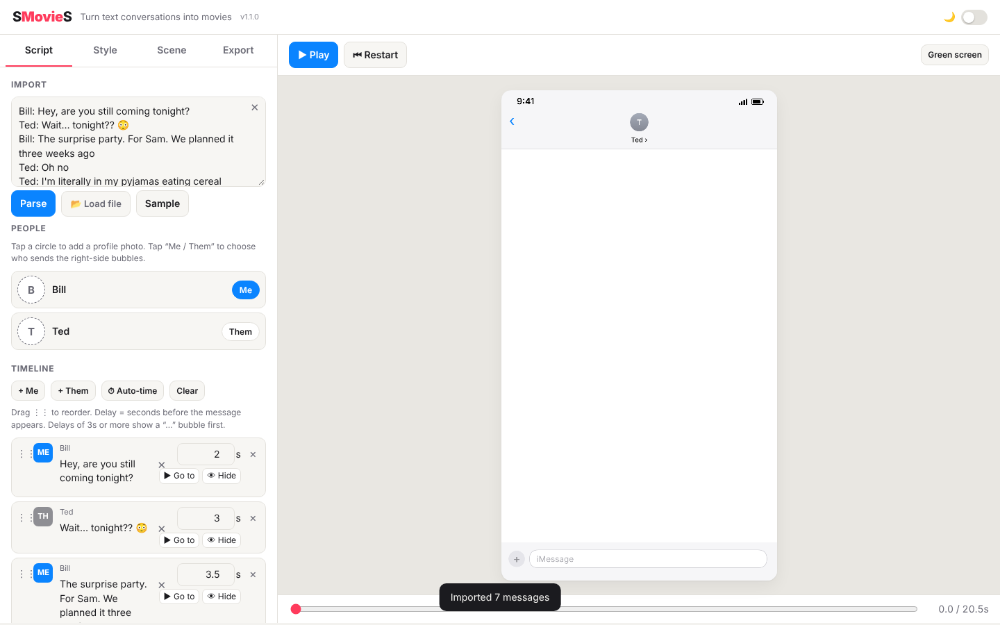

# SMovieS

[Launch SMovieS now.] (https://dougalder.github.io/SMovieS/smovies.html)

**SMovieS turns a text conversation into a short movie.** Paste in a chat, arrange the messages, choose how the phone screen should look, then record it as a video (with sounds) or an animated GIF.



## What's in this repository

| File | What it is |
|------|------------|
| `smovies.html` | **The app itself.** This is the main file. Open it to make movies. |
| `index.html` | A small start page. Opening it automatically sends you to `smovies.html`. |
| `MANUAL.md` | A step-by-step guide for users, with screenshots. |
| `README.md` | This file. |
| `LICENSE` | The terms under which the project may be used. |
| `THIRD_PARTY_LICENSES.md` | Credit and licence text for outside code used inside the app. |
| `screenshots/` | Pictures of the app, used in this file and the manual. |

## How to use it in 30 seconds

1. Download or clone this repository (see below).
2. Double-click `smovies.html`. It opens in your web browser.
3. Click **Sample** to load an example conversation, or paste your own chat into the **Script** tab.
4. Click **▶ Play** to preview, then go to the **Export** tab and click **⬇ Export movie**.

The full guide is in [MANUAL.md](MANUAL.md).

## Getting the files

**Option A: download a zip file (easiest)**

1. On the repository page on GitHub, click the green **Code** button.
2. Click **Download ZIP**.
3. Double-click the downloaded zip file to unzip it.
4. Open the folder and double-click `smovies.html`.

**Option B: use Git (for developers)**

Git is a free tool for tracking changes to files:

```
git clone https://github.com/YOUR-USERNAME/smovies.git
```

Replace `YOUR-USERNAME` with the GitHub account name that hosts the repository.

## Browsers and devices

The app is one web page, so it needs no installation. It is designed for:

- **Safari** on a Mac, iPhone and iPad
- **Chrome**, **Edge** and **Firefox** on Windows, Mac, Linux and Android

**Recording tip:** Video recording depends on the browser. Chrome and Edge are the most reliable for recording movies. If you see "This browser can't record video", switch to Chrome or Edge.

## Features

- **Import** a conversation by pasting text, or by loading a file. It understands:
  - Simple lines such as `Name: message`
  - WhatsApp chat exports (`.txt`)
  - iMessage-style text copied from a Mac
  - Instagram message exports (`.json`)
  - X (formerly Twitter) direct-message archives (`.js`)
- **Timeline editor**: reorder messages by dragging, change who sent each one, edit the text, set how long each message waits, and delete messages.
- **Automatic timing** based on message length, plus a "typing…" bubble for slower messages.
- **Nine looks**: iMessage, SMS, WhatsApp, Messenger, Instagram, X, Android, Telegram, Signal, and a playful Comic style.
- **Colours, text size, bubble width, spacing, names, timestamps and profile photos** can all be adjusted.
- **Scenes**: a phone screen, a plain colour, your own photo or video behind the chat, or a green or blue screen for video editing.
- **Movable chat layer**: drag the conversation on the preview and resize it by scrolling the mouse wheel over it.
- **Frame shapes** for different platforms: 9:16 (stories and short videos), 1:1 (square), 4:5 (portrait posts) and 16:9 (widescreen).
- **Sound effects** for each message, with four sound choices and volume control.
- **Export** to a video file (with sound) or an animated GIF.
- **Night mode** switch in the top-right corner.

## Privacy

SMovieS does not upload your conversations, photos or videos anywhere. Everything happens inside your browser on your own device. When you close the page, the work is lost unless you export it, because the app does not save projects between visits.

Because your chats may contain personal information, only use real conversations you have permission to share.

## Technical notes (optional reading)

- The app is a single file, `smovies.html`. It contains the layout (HTML, short for HyperText Markup Language), the styling (CSS, short for Cascading Style Sheets) and the program logic (JavaScript).
- Drawing is done on a canvas, which is a blank area in the page that the program paints onto frame by frame.
- Videos are recorded with the browser's built-in recorder. Output is MP4 (a widely used video format) when the browser supports it, and WebM (an open video format) otherwise.
- GIFs are built inside the app using a small, built-in encoder. Its licence is listed in `THIRD_PARTY_LICENSES.md`.

## Known limitations

- Projects are not saved between visits. Export your movie or GIF to keep it.
- Exports save straight to your Downloads folder. There is no "Open after saving" option yet.
- Green-screen footage must be keyed (have its green background removed) in a separate video editor. The app only supplies the coloured background.
- Timeline text is always editable; there is no separate "edit, then confirm" step yet.

## Version history

- **1.1.0**: Version number shown in the header; SMovieS icon in the browser tab; ✕ button to clear text boxes; number box beside every slider and larger sliders on touch screens; paste a picture or video (Cmd+V / Ctrl+V) as the background; transparent pictures are trimmed to their visible part with a 24-pixel margin; export file names in the form `2026-10-24 SMovieS-9x16 Story-1080p.mp4`; ▶ Go to and 👁 Hide / Show buttons on each message; a message when recording starts.
- **1.0.0**: First release. Import, timeline editor, nine message styles, scenes, movie and GIF export.

## Questions or problems

Open an issue on the GitHub repository page. Describe what you did, what you expected, and what happened instead. Include your browser name and version, and whether you were using a Mac, iPhone, Windows PC or Android device.
